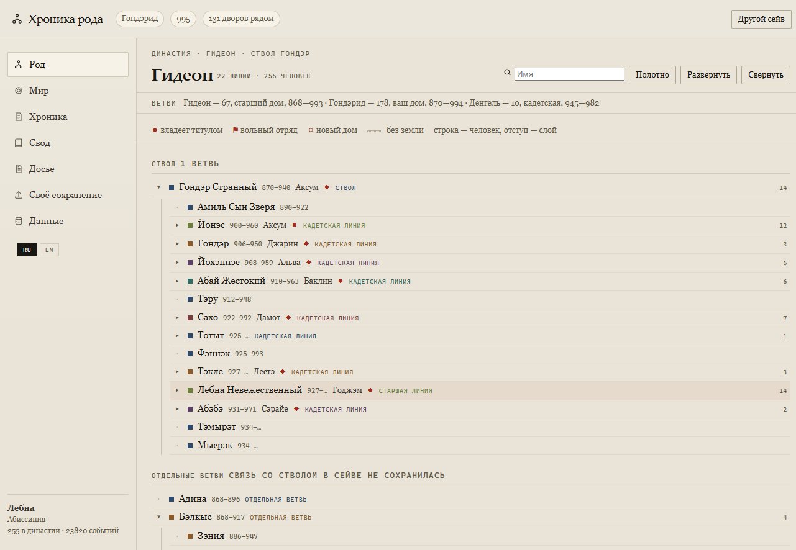
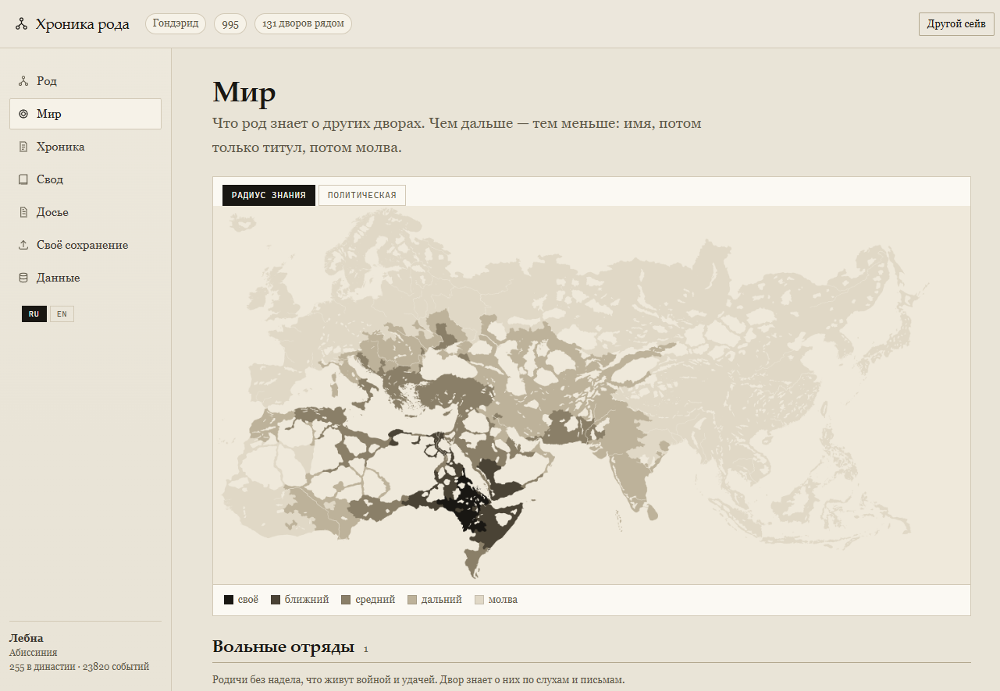
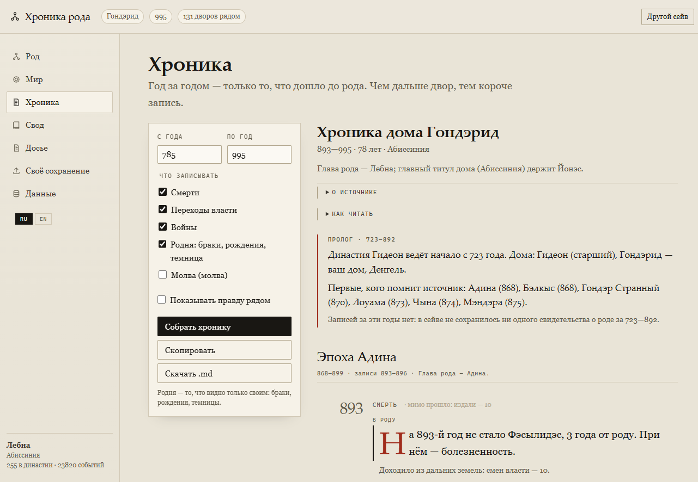
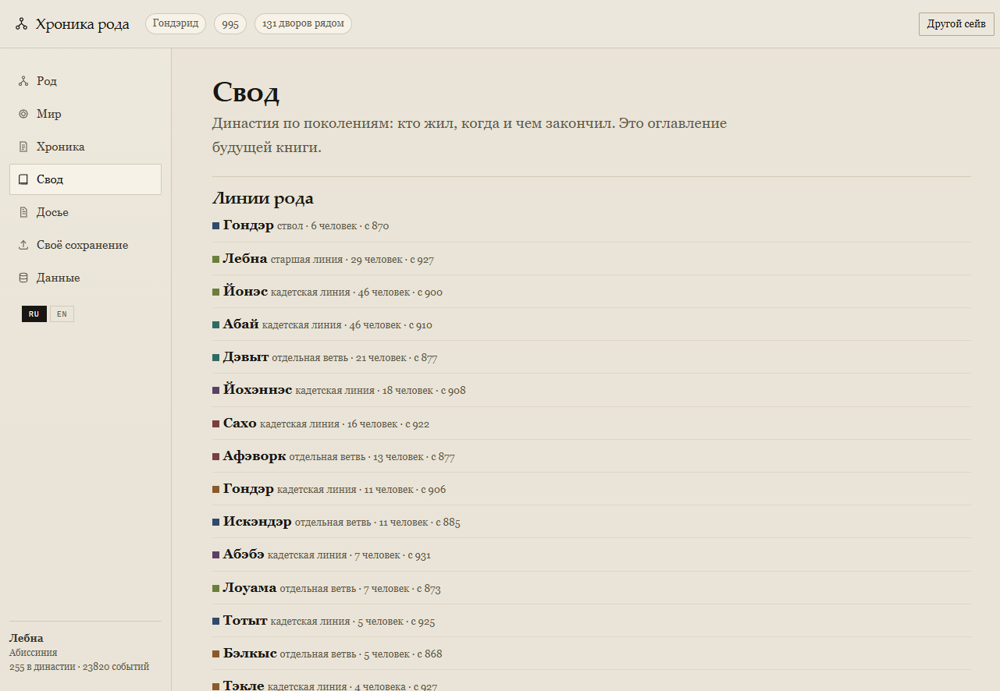

# Chronicle of the House

**Alpha 0.1.0** · Crusader Kings III 1.20.x


[Русская версия](README.md) · [Changelog](CHANGELOG.md) · [Release notes](RELEASE_NOTES.md) · [Contributing](CONTRIBUTING.md)

A local, offline app that turns a Crusader Kings III save into a **family chronicle**: not everything that happened in the world, but what actually reached the family — through its own records, its kin, and hearsay.

The interface itself is in Russian, because it is built from a Russian-localized save; this document covers setup and usage for English speakers.

## Quick start

1. Download or clone this repository.
2. **Windows:** double-click `start.cmd`.
   **macOS / Linux:** run `./start.sh`.
3. The browser opens at `http://127.0.0.1:8778/`.

That is the whole setup. The launcher needs either **Node.js** (recommended, no dependencies) or **Python 3** — whichever is already installed.

Other ways to start:

| command | what it does |
|---|---|
| `npm start` | same server through npm, opens the browser |
| `node tools/serve.js --port 9000` | custom port |
| open `app/index.html` directly | works, because the demo world is also stored as `world.js` |

The demo world is a 995 campaign of the House of Gondärid: 134 realms in view, 23 829 events, 21 dynasty members holding land.

## Import your own save

**From the app.** Start it with `start.cmd` (or `./start.sh`) and open **Своё сохранение** (your save) in the sidebar:
the page lists the saves found in your CK3 folder, asks for the game folder once, and runs the conversion with a live log.
When it finishes, the chronicle reloads by itself. If no world is built yet, the app opens this page at startup.

**From the command line.**

1. Double-click `import.cmd` (Windows) or run `./import.sh`.
2. Drag your `.ck3` file into the window and press Enter.
3. Point to the game folder — the one that contains `map_data/` and `common/`, usually
   `…/Steam/steamapps/common/Crusader Kings III/game`.

The importer reads the save with the extractor, builds the world and the map, and puts
everything into `app/_data/`. A minute or two later, start the app as usual.

**A save does not contain a map.** CK3 keeps map geometry in the game folder
(`map_data/provinces.png`, `common/landed_titles`), so the importer asks for that folder once.
The map is then copied into the project (`_cache/map_data/`), and later imports no longer need the game path.
Without it the world is still built, but the app shows only the textual map.

The copy stays local: `_cache/` is in `.gitignore`, because the map is a Paradox asset and is not redistributed
with the project. The demo world already ships with its rendered maps, so the app works offline out of the box.

Everything can be passed as flags for unattended runs:

```powershell
python tools/import_save.py --save "C:\saves\autosave.ck3" `
    --game "C:\Steam\steamapps\common\Crusader Kings III\game" `
    --extractor "C:\tools\ck3_history_extractor.exe" --yes
```

`--lang` selects the localization used for names (default `russian`; use `english` for English names).

## What it looks like

| House | World |
|---|---|
|  |  |

| Chronicle | Compendium |
|---|---|
|  |  |

## Interface language

The interface switches between Russian and English with the **RU / EN** buttons at the bottom of the sidebar; the choice is remembered. The browser language is used by default.

The chronicle and dossier texts stay in the language of the save: they are quotes from the source, not interface labels. A save with the Russian localization gives a Russian chronicle, an English one gives English.

## What is inside

Five screens:

- **House** — the family as an indented outline: one line per person, indentation per generation, collapsible. Cadet lines are marked, rulers are labelled with what they held. A canvas tree with pan and zoom is the second mode.
- **World** — what the house knows about other courts. Two lenses: *radius of knowledge* (the further away, the less is known) and *political*.
  The political lens has two layers: **by house** — every realm is tinted with the colour of its ruler's house, so the map works even when your family holds nothing; and **family lands** — counties held by kin, with a numbered dot per ruler.
- **Chronicle** — the record itself, in chapters by era, each year split into three layers: **in the family**, **at court and nearby**, **from afar** (counted, not listed). Wars and feuds carry a thread back to their beginning.
- **Compendium** — generations, branches, who holds what.
- **Dossier** — a fact pack for a storyteller, human or model.

## Building a world from your own save

You need: a `.ck3` save, the game, the extractor — and Python packages `ijson`, `numpy`, `pillow`.
The import page checks them and offers a one-click install; manually it is
`python -m pip install -r requirements.txt`.

**Getting the extractor.** It is a third-party project, [TCA166/CK3-history-extractor](https://github.com/TCA166/CK3-history-extractor) (MIT). No `.exe` is shipped here: build it from source or take the author's release.

The app looks for `ck3_history_extractor*.exe` next to the project, one and two folders up, and in `Documents/.../Crusader Kings III/mod`. If it is somewhere else, the import page has an **Extractor** field — paste the full path once. Version 2.4.7 does not understand the 1.20 save format, so apply `patches/extractor-1.20.patch` (see below).

Paths are passed as arguments or environment variables — there are no hard-coded drives in the scripts:

```powershell
$env:CK3_GAME = "C:\Program Files (x86)\Steam\steamapps\common\Crusader Kings III\game"

# 1. map cache — once per game install
python tools/knowledge_pilot.py map
python tools/knowledge_pilot.py adjacency

# 2. dump the save
ck3_history_extractor.exe "save.ck3" -g "$env:CK3_GAME" `
    -l russian -o out -n --no-vis --dump out\gamestate.json

# 3. build the world and its map
python tools/build_world.py --dump out\gamestate.json `
    -o app\_data\world.json --map app\_data\world-map.png
```

Without `--game` the world is still built, just without a map: the map needs `map_data` and `common/landed_titles` from the game.

Text saves are read directly. Binary saves (autosaves, ironman) need tokens: `tools/tokens.ps1` launches the game, waits for `oos_dump` and picks up `tokens_1.tok`.

## Extractor and the 1.20 save format

The patch fixes what 2.4.7 could not handle:

- unknown tokens become `__token_N` placeholders instead of a crash;
- broken sections are skipped with a warning instead of aborting the run;
- houses, lineages, memories and cultures are parsed defensively;
- `dead_unprunable` is read both as a map (1.19) and as an array (1.20), one character at a time — see `patches/dead-unprunable.md`;
- the `faiths` section is read as faith definitions, and `religion` / `county_manager` are no longer dropped, so realm culture is preserved — see `patches/religion-1.20.md`.

Applying the patch to clean sources:

```powershell
git apply -p1 patches/extractor-1.20.patch
```

## Tests

```powershell
npm install
npm test
```

Four suites: app (37 checks), house outline (15), chronicle (14), map lenses (12). They run in jsdom, no browser needed.

## Data and privacy

The repository contains one demo world, built from a personal save; it holds names that come from the game. If you would rather not publish game data, delete `app/_data/` and build your own: the app then shows an empty state with instructions.

Saves (`.ck3`), dumps (`gamestate.json`, hundreds of megabytes), the map cache and token files are not in the repository — they are covered by `.gitignore`.

The demo world is stored twice: `world.js` (so that opening `index.html` by double-click works) and `world.json` (read by the server and by tests). That is 15 MB out of 16.

## If the app shows no dynasty

Run the doctor on a dump — it prints what was actually parsed:

```powershell
python tools/doctor.py --dump out/gamestate.json
```

It reports the date, how many dynasties and houses were read, how many houses are linked to a dynasty, how many characters carry a house, and what the current world in `app/_data` contains. Three typical readings are printed at the end.

## Known limitations

- **Faith is not available.** The 1.20 save stores faith definitions (108 of them) but no link from people or counties to a faith, so the app says so instead of guessing. Culture works.
- **Dates and names come from the save only.** Where the game did not record a name, the chronicle says "name unknown" rather than inventing one.
- **Causes are not in the save.** The game records that someone was imprisoned or that a title changed hands, not why; the chronicle does not fill that gap.

## License

Application code and tools are MIT, see `LICENSE`. Third-party notices are in `NOTICE`: the extractor patch is derived from TCA166/CK3-history-extractor (MIT). Game data and localization belong to Paradox Interactive; this project is not affiliated with Paradox and does not redistribute game files.
