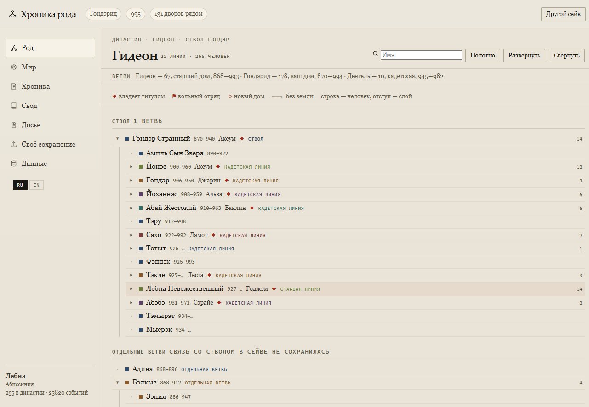
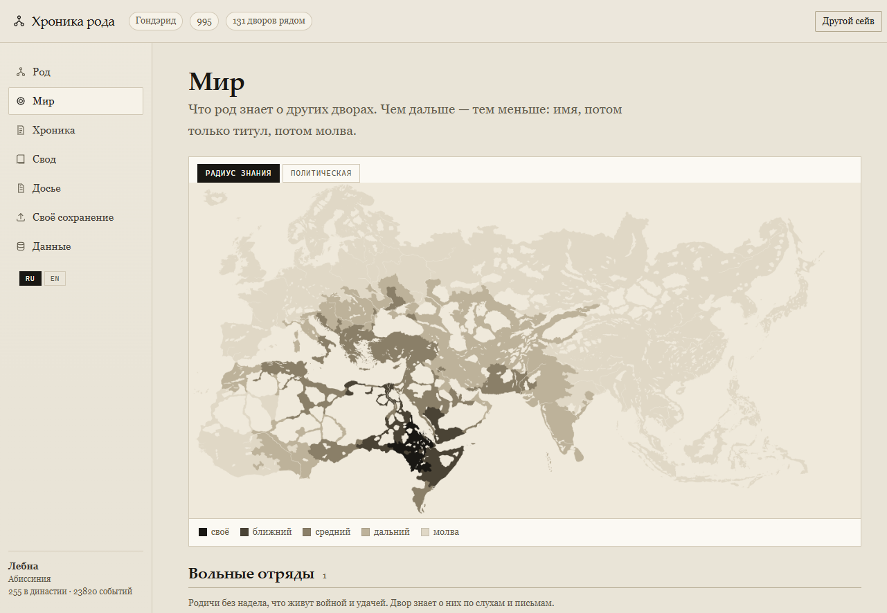
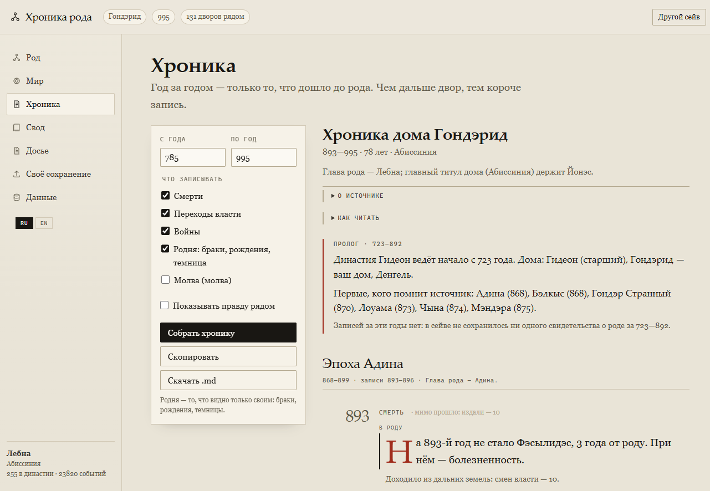
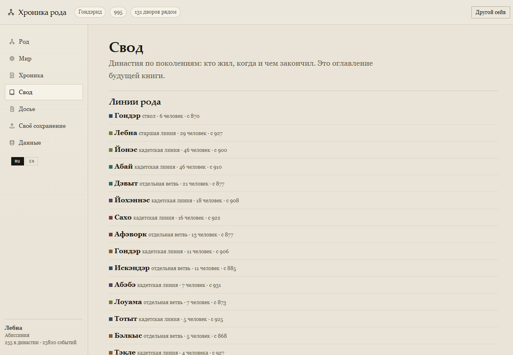
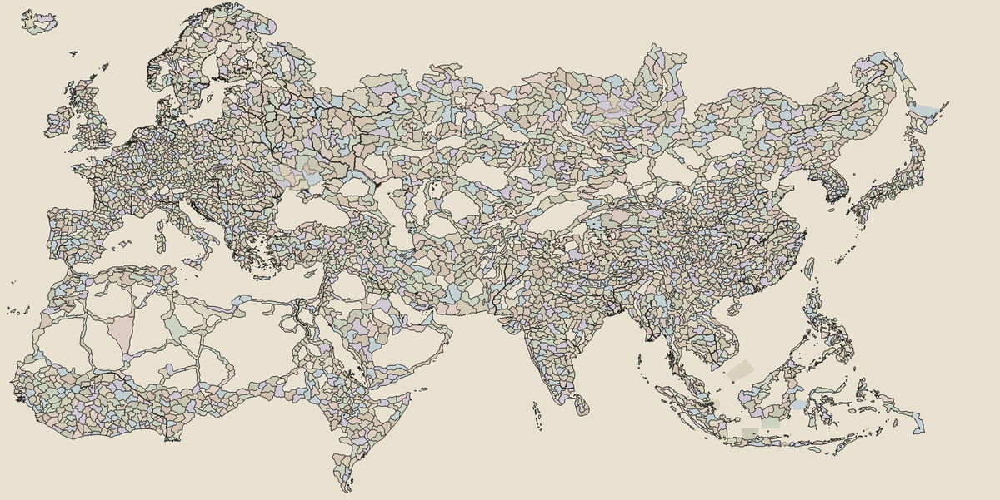

# Хроника рода

**Альфа 0.5.0** · Crusader Kings III 1.20.x


[English](README.en.md) · [Изменения](CHANGELOG.md) · [Заметки к выпуску](RELEASE_NOTES.md) · [Как помочь](CONTRIBUTING.md)

Летопись семьи из сохранения Crusader Kings III. Приложение смотрит на мир **глазами рода**: не всё, что произошло, а то, что до семьи дошло.

**Хроника** разделена на главы по эпохам рода, у каждой главы — годы правления и итоги: сколько смертей, войн, браков. Внутри года запись идёт тремя слоями: **в роду** (своё), **при дворе и рядом** (соседи и войны), **издали** (счёт вестей, без имён). Войны и распри тянут нить: при победе стоит год начала войны, при смерти участника ссоры — год её начала. Строки начинаются по-разному, а не сплошным «В лето…», и в конце года стоит честный счёт: сколько вестей прошло мимо и по каким слоям.

Шесть экранов: **Род** (древо династии), **Мир** (карта знания, дворы по кольцам, вольные отряды), **Хроника** (летопись по годам), **Свод** (поколения), **Досье** (пакет фактов для рассказчика — человека или модели).

Карта — две линзы, переключаются над ней:

- **Радиус знания** — вся карта мира, цвет по кольцам: чем темнее, тем ближе двор к роду.
- **Политическая** — кадр вокруг земель рода. У каждого дома свой цвет: ваш — киноварь, старший дом — индиго, кадетские ветви — олива, охра, слива, бирюза. Названия домов подписаны прямо на карте; у каждого правителя из династии — точка с номером, а легенда сгруппирована по домам: роль ветви, графства, правители. Чужие державы обозначены только границами — королевства и империи тушью, герцогства светлее. У линзы своя карта индексов, поэтому наведение мыши работает и в приближённом кадре. Те же цвета домов стоят в легенде ветвей на экране «Род».

**Род** показывается конспектом: каждый человек — строка, отступ — слой. Гондэр на нулевом слое, его дети на первом, внуки на втором и так далее. Так видно и братьев рядом, и глубину ветви, и ничего не наезжает друг на друга. Свёртывание прячет дальние слои: по умолчанию открыты два, кнопка «Развернуть» показывает весь род. Цвет метки слева — дом (тот же, что на политической карте), «◇» — человек, с которого пошёл новый дом, «◆» — владеет титулом, «⚑» — вольный отряд. У основателей линий стоит пометка «старшая линия» или «кадетская».

Второй режим — полотно с линиями и панорамой: кнопка «Полотно» в шапке экрана.

Карточка человека отвечает на вопрос «кто это»: родство с вами (отец, дед, дядя, двоюродный брат, свойственник), владения, культура из сейва и вера — либо честная строка о том, что вера в дампе 1.20 не сохранилась.

Древо: поколения подписаны и идут рядами, внутри ряда — по ветвям домов; связи ортогональные, браки — пунктиром. Владелец титула выделен, безземельный обведён тонко, чужая ветвь — пунктиром. Кнопка «Список» переключает на перечень по поколениям с раскрытием карточки на месте. «Показать родню» в панели оставляет на экране только родителей и потомков выбранного человека.

Хроника пишется о владеющих титулом: кто держал землю сейчас или прежде, тот и в записи. Безземельный родич попадает в летопись один раз и только по существу — рождение, брак, смерть, война; темницы и дружбы остаются в досье. Смена власти по одному титулу — одна строка в год.

**Причина, а не только факт.** У идущей войны игра хранит повод (`casus_belli`) и целевые титулы — экстрактор их не отдаёт, поэтому их читает `tools/save_reader.py` прямо из текстового `gamestate`, а `build_world.py --extra` подмешивает: метка повода перед строкой, причина и цель в тексте. Но идущие войны — только вершина: у каждой войны в памяти персонажа есть дата, противник и категория повода (`war_cb`) — оттуда причина есть и у давно закончившихся войн. Имена поводов берутся из локализации самой игры (`tools/cb_names.py`), а не из головы: «Малая священная война», «Покорение герцогства», «Война за объединение Китая». От семейства повода зависит фраза: за веру, за дань, за верховенство, за вольности, за землю. Где титул-цель уже успел перейти — в строке есть исход. Причина смерти приходит из данных игры как есть («во сне», «от старости»). Что именно даёт сейв, а что дамп, и как это проверить — [docs/data-invariants.md](docs/data-invariants.md).

**Титулы — из трёх свидетелей.** История титула в дампе обрывается на старте партии; историю по ходу партии даёт сейв; причину знает только память персонажа (`landed_title`, `reason`, `new_holder`). `tools/titles.py` сводит их в одну запись — и тогда в летописи появляется «Синин: власть перешла к Пасанг — уступлен по требованию фракции» и «Яньцин лишился титула «Гуаньнэй» — уступлен по требованию фракции». На сейве 913 года память дала 5 715 совпадений с историей и добавила 267 записей, которых в истории нет; потерь титула с именем было 0 из 311, стало 98 из 98. Проверка — `tools/check_titles.py` (даты, повторы, живые держатели, причины, циклы вассалитета), подробности — [docs/titles.md](docs/titles.md).

## Как это выглядит

| Род | Мир |
|---|---|
|  |  |

| Хроника | Свод |
|---|---|
|  |  |

| Карта титулов |
|---|
|  |

## Подключить своё сохранение

**Из приложения.** Запустите `start.cmd` (или `./start.sh`) и откройте в боковом меню **«Своё сохранение»**:
страница покажет найденные сейвы, один раз спросит папку игры и запустит конвертацию с журналом.
По окончании хроника перезагрузится сама. Если мир ещё не собран, приложение открывает эту страницу при старте.

**Из командной строки.**

1. Двойной щелчок по `import.cmd` (Windows) или `./import.sh`.
2. Перетащите в окно файл `.ck3` и нажмите Enter.
3. Укажите папку игры — ту, где лежат `map_data/` и `common/`, обычно
   `…/Steam/steamapps/common/Crusader Kings III/game`.

Импортёр снимет дамп, соберёт мир и карту и положит всё в `app/_data/`. Через минуту-две
запускайте приложение как обычно.

**В сейве карты нет.** CK3 хранит геометрию карты в папке игры (`map_data/provinces.png`,
`common/landed_titles`), поэтому импортёр и спрашивает её — один раз. Дальше карта копируется
внутрь проекта (`_cache/map_data/`), и следующие импорты обходятся без папки игры. Без неё мир
тоже соберётся, но останется только «Карта словами».

Копия лежит локально: `_cache/` в `.gitignore`, потому что карта — ассет Paradox, и в проект она
не входит. Демо-мир уже идёт с готовыми отрисованными картами, так что приложение работает офлайн из коробки.

Всё можно передать флагами, без вопросов:

```powershell
python tools/import_save.py --save "C:\saves\autosave.ck3" `
    --game "C:\Steam\steamapps\common\Crusader Kings III\game" `
    --extractor "C:\tools\ck3_history_extractor.exe" --yes
```

`--lang` задаёт локализацию имён (по умолчанию `russian`, для английских имён — `english`).

## Как это выглядит

| Род | Мир |
|---|---|
|  |  |

| Хроника | Свод |
|---|---|
|  |  |

## Язык интерфейса

Интерфейс переключается между русским и английским кнопками **RU / EN** внизу бокового меню; выбор запоминается. По умолчанию берётся язык браузера.

Текст хроники и досье остаётся на языке сейва: это цитаты из источника, а не подписи интерфейса. Сейв с русской локализацией даёт русскую летопись, с английской — английскую.

## Что внутри

```
app/                 локальное приложение: HTML + CSS + JS, без сборки
  js/                модули приложения: ядро, род, карта, хроника, свод, досье, оболочка, импорт
  _data/world.json   мир из сейва: дата, люди, события, карты
tools/
  knowledge_pilot.py карта: провинции, баронства, соседство, кольца
  build_world.py     сборка мира из дампа: державы, люди, события, досье
  tokens.ps1         токены для бинарных (ironman) сейвов
  app_scripts.js     порядок модулей из index.html — общий для страницы и проверок
  serve.js           локальный сервер и API импорта
  save_reader.py     войны и история титулов из текстового gamestate
  cb_names.py        имена поводов из локализации игры
  titles.py          модель титула: дамп, сейв, память персонажа
  title_map.py       провинция → графство → герцогство → королевство → империя
  titles_render.py   карта титулов и карта индексов
  import_save.py     импорт сейва: дамп, сборка мира, карта
  check_app.js       37 проверок приложения в jsdom
  check_tree.js      15 проверок древа: поколения, фокус, список, поиск
  check_chronicle.js 40 проверок хроники: главы, слои, нити, титулы, чистота данных
  check_lens.js      21 проверка карты: три линзы, зум, цепочка титулов
  check_titles.py    проверка титулов и карты титулов
  check_dump.py      эталон дампа экстрактора
  doctor.py          разбор проблемного дампа
patches/
  extractor-1.20.patch  правки CK3-history-extractor для сейвов 1.20
  dead-unprunable.md    умершие предки: почему дерево обрывалось
  religion-1.20.md      вера и культура: что читается, а что сейв не отдаёт
```

## Быстрый старт

1. **`start.cmd`** (Windows) или **`./start.sh`** (macOS, Linux) — один двойной щелчок: сервер поднимется и браузер откроется сам. Нужен Node или Python.
2. `npm start` — то же через npm.
3. Или двойной щелчок по `app/index.html`: страница подхватит `_data/world.js`.

Мир в `app/_data` собран из сохранения: кампания 917 года, дом Чжу — 260 держав в поле зрения (из 741), 22 651 событие, 11 родичей в династии, 11 378 событий с причиной. Культура держав и людей читается; вера — нет: в сейве 1.20 определения вер есть, а привязки к людям и графствам нет, и досье говорит об этом прямо. Свой мир собирается той же командой (см. ниже).

## Свой мир из своего сейва

Нужны: сохранение `.ck3`, игра Crusader Kings III, экстрактор — и Python-пакеты `ijson`, `numpy`, `pillow`.
Страница импорта их проверяет и предлагает установить одной кнопкой; вручную — `python -m pip install -r requirements.txt`.

**Где взять экстрактор.** Это сторонний проект [TCA166/CK3-history-extractor](https://github.com/TCA166/CK3-history-extractor) (MIT). Приложение ищет `ck3_history_extractor*.exe` рядом с проектом, на уровень и два выше, а также в `Documents/.../Crusader Kings III/mod`. Если он лежит в другом месте — на странице импорта есть поле **«Экстрактор»**: вставьте полный путь один раз. Собирать не нужно: в [Releases](https://github.com/agapovpavel387-code/ck3-chronicle/releases) лежит готовая сборка под 1.20 — `ck3_history_extractor-2.4.7-ck3-1.20-win64.zip`. Распакуйте её в `vendor/` проекта: там окажутся `ck3_history_extractor.exe` и папка `templates/`, которую он ищет рядом с собой. Версия 2.4.7 без патча не понимает формат 1.20: в готовой сборке он уже применён, а как применить его к чистым исходникам — ниже.

Пути к игре и дампу задаются аргументами или переменными окружения — в скриптах нет чужих дисков:

```powershell
$env:CK3_GAME = "C:\Program Files (x86)\Steam\steamapps\common\Crusader Kings III\game"

# 1. карта — один раз
python tools/knowledge_pilot.py map
python tools/knowledge_pilot.py adjacency

# 2. дамп сейва экстрактором
ck3_history_extractor.exe "сейв.ck3" -g "$env:CK3_GAME" `
    -l russian -o out -n --no-vis --dump out\gamestate.json

# 3. войны с поводами и история титулов — чего в дампе нет
python tools/save_reader.py --save "сейв.ck3" --out _cache\save-extra.json

# 4. имена поводов из локализации игры (один раз на установку)
python tools/cb_names.py --game "$env:CK3_GAME" --out _cache\cb-names.json

# 5. мир и карта
python tools/build_world.py --dump out\gamestate.json --extra _cache\save-extra.json `
    -o app\_data\world.json --map app\_data\world-map.png
```

Без `--extra` мир соберётся, но без войн и с потерянной частью истории титулов;
без `cb-names.json` поводы назовутся словами из `build_world.py`. Шаги 3 и 4
`tools\import_save.py` делает сам — вручную они нужны только при сборке по частям.

Без `--game` мир соберётся без карты: для неё нужны `map_data` и `common/landed_titles` из игры.

Текстовые сейвы (ручные сохранения) разбираются штатно. Бинарные (автосейвы, ironman) требуют токенов — их снимает `tools/tokens.ps1`. Готовый `tokens_1.tok` положите рядом с экстрактором (`vendor/` проекта или папка, где лежит `ck3_history_extractor.exe`): экстрактор ищет его рядом с собой, в рабочей папке и в `%USERPROFILE%`.

Экстрактору нужна и папка `templates/` рядом с exe: он ищет её относительно рабочей папки, а без неё падает с «Internal templates requested but not compiled in». В архиве из Releases она уже лежит рядом с exe; если собираете сами — положите `templates/` рядом с экстрактором.

## Экстрактор и сейвы 1.20

CK3-history-extractor 2.4.7 не знает формат 1.20: падает на домах, не понимает новые секции, требует таблицу токенов. В `patches/extractor-1.20.patch` — правки, которые это чинят:

- неизвестный токен → заглушка `__token_N` вместо падения;
- битые секции пропускаются с предупреждением;
- безопасный разбор домов, родословных, памяти и культур;
- при `--dump --no-vis` HTML не рендерится (там падали шаблоны);
- `dead_unprunable` читается и как карта (1.19), и как массив (1.20), персонажи разбираются по одному — см. `patches/dead-unprunable.md`.
- раздел `faiths` читается как определения вер, `religion` и `county_manager` больше не отбрасываются: культура держав на месте — см. `patches/religion-1.20.md`.

Готовая сборка с этими правками — в Releases; дальше — для тех, кто собирает сам.

Применение к чистым исходникам:

```powershell
git apply -p1 patches/extractor-1.20.patch
cargo build --release --features permissive
```

## Проверка

```powershell
npm install
npm test
```

Четыре набора: приложение (37 проверок), род (15), хроника (14), карта (12). Гоняются в jsdom, браузер не нужен.

## Данные и приватность

В репозитории лежит один демо-мир: он собран из игрового сохранения и содержит только названия, которые генерирует сама игра, — династии, дома, провинции, события. Путей, адресов и прочих личных данных в нём нет (это проверено по всем строкам `world.json`). Мир записан дважды: `world.js` (чтобы работал двойной щелчок по `index.html`) и `world.json` (его читает сервер и проверки). Это 15 МБ из 16 — если размер важнее удобства, оставьте только `world.js`: приложение подхватит его и без сервера. Если не хотите публиковать даже игровые данные, удалите `app/_data/` и соберите мир сами: приложение покажет пустой экран с инструкцией.

Сохранения `.ck3`, дампы `gamestate.json` (сотни мегабайт), кэш карты и таблицы токенов в репозиторий не входят — они в `.gitignore`.

## Построено на

Чтение сохранений делает [CK3-history-extractor](https://github.com/TCA166/CK3-history-extractor) — сторонний проект TCA (Tomasz Chady). Он один умеет то, чего не умеет игра: развернуть `.ck3` в персонажей, титулы, дома, культуры и события. Всё остальное здесь — только то, как эти факты рассказать.

Спасибо, TCA. Без вашего экстрактора этого приложения не было бы: в `patches/` лежат правки под формат 1.20, но сама возможность прочитать сейв — ваша работа.

## Лицензия

Код приложения и инструментов — MIT (см. `LICENSE`).

`CK3-history-extractor` принадлежит TCA и распространяется по MIT — см. `NOTICE`. Патч из `patches/` — производная работа на тех же условиях.

Crusader Kings III и её тексты — собственность Paradox Interactive. Проект не связан с Paradox и не распространяет файлы игры.
